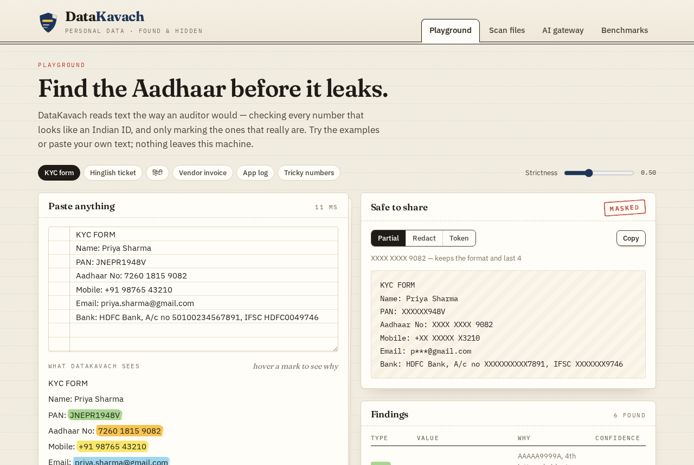
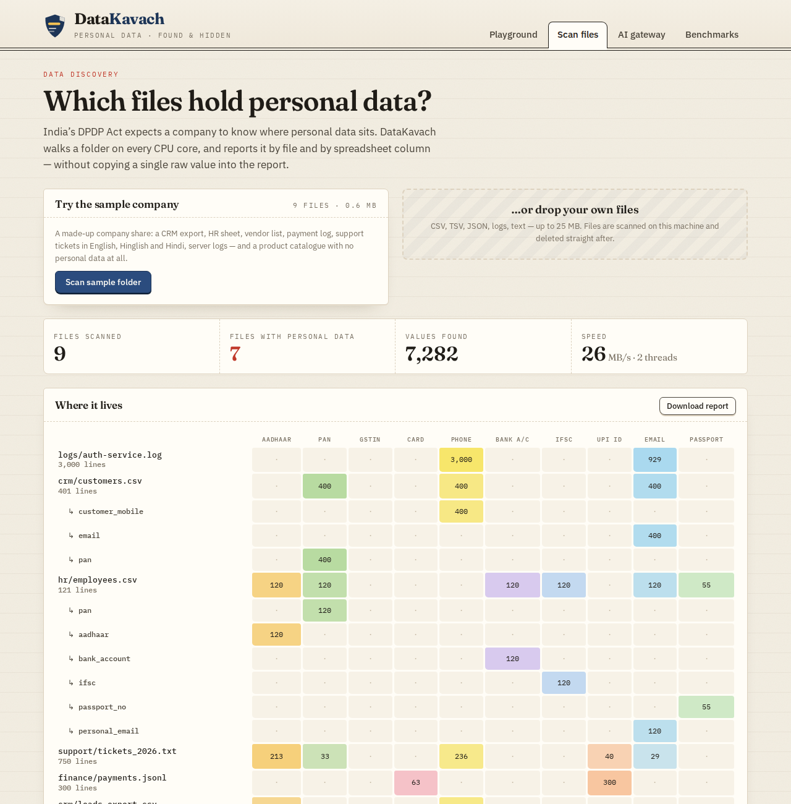
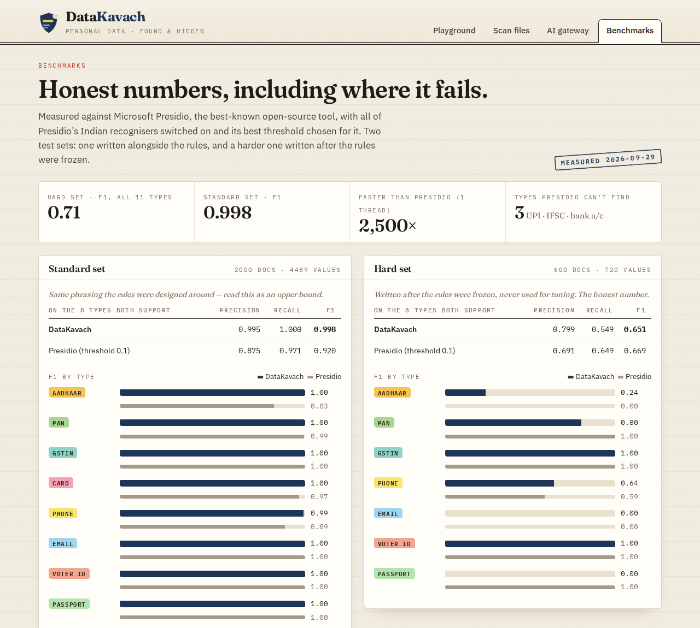
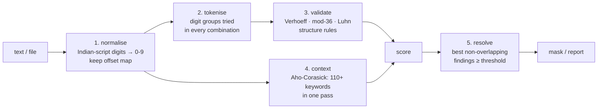

# DataKavach

**Finds and hides Indian personal data — Aadhaar, PAN, GSTIN, UPI IDs, phone, bank details — in company files and in AI prompts.**

India's **Digital Personal Data Protection (DPDP) Act, 2023** expects companies to know where personal data sits and to protect it. In practice it sits everywhere: CRM exports, HR sheets, support tickets, server logs, and in text employees paste into ChatGPT. Generic tools are built for US data (SSNs, US phone numbers) and don't understand Indian identifiers.

DataKavach is a **C++ engine** with a **Next.js dashboard** that:

1. **Finds** 11 kinds of Indian personal data, and **checks they are real**: Aadhaar numbers must pass the Verhoeff checksum, GSTINs their mod-36 check character, cards the Luhn check. A random 12-digit order number is not an Aadhaar number.
2. **Understands context**: "Aadhaar no:", "mob no", "आधार", "मोबाइल" raise confidence; "Order ID", "UTR", "PNR" lower it. It also reads digits written in 9 Indian scripts (७२६० १८१५ ९०८२).
3. **Scans folders** on every CPU core and reports *where* the data lives — per file and **per spreadsheet column** — without copying any raw value into the report.
4. **Masks** text three ways: partial (`XXXX XXXX 9082`), redact (`[AADHAAR]`) or reversible tokens (`[AADHAAR_1]`).
5. **AI gateway**: masks a prompt before it reaches an LLM, then puts the real values back into the answer on your side.



| Scan a folder | Honest benchmarks |
|---|---|
|  |  |

> Everything in this repository is **synthetic**. The IDs pass their real checksums but were generated for this project; none belongs to a real person on purpose.

---

## Results

Compared with **Microsoft Presidio** (the best-known open-source PII tool) with all its Indian recognisers switched on and its best score threshold chosen for it. A prediction counts as correct when the type matches and it overlaps the labelled value by at least 50%.

| F1 score, on the 8 types both tools support | DataKavach | Presidio |
|---|---|---|
| **Standard set** (2,000 documents, 4,489 values) | **0.998** | 0.920 |
| **Hard set** (600 documents, 720 values) | 0.651 | **0.669** |

| Speed (same machine, 1 thread) | DataKavach | Presidio |
|---|---|---|
| MB of text per second | **30 MB/s** | 0.013 MB/s |

**How to read this honestly:**
- The **standard set** was written alongside the rules, so its score is an upper bound.
- The **hard set** (`data/hard.py`) was written *after* the rules were frozen and was never used to tune them: OCR noise, numbers broken across lines, obfuscated emails (`name [at] gmail [dot] com`), lower-case IDs, and business words the engine doesn't know. On it, DataKavach and Presidio are about equal on shared types. The benchmarks page lists exactly which cases fail.
- DataKavach's real advantages: it is **more than 2,000× faster** (no language model in the loop), and it covers **UPI IDs, IFSC codes and bank account numbers**, which Presidio doesn't. On all 11 types, its hard-set F1 is 0.709.
- Speed was measured on a 2-core cloud machine with deliberately dense text (a value every ~60 bytes). A laptop, or ordinary files with less personal data, will be faster.

Reproduce: `python3 eval/evaluate.py --presidio` (writes `eval/results.json`, which the dashboard reads).

---

## How it works



Every step is linear in the length of the text. The details, and the questions an interviewer is likely to ask, are in **[docs/HOW_IT_WORKS.md](docs/HOW_IT_WORKS.md)**.

| Part | Tech | What it does |
|---|---|---|
| `engine/` | **C++17**, CMake, no dependencies | Detection, validation, masking, multi-threaded folder scan, CLI |
| `web/` | **Next.js 16**, React 19, hand-written CSS | Playground, scan report, AI gateway, benchmarks. API routes call the engine binary |
| `data/` | Python | Synthetic labelled data (standard + hard sets) and a demo "company share" |
| `eval/` | Python, Presidio | Precision / recall / F1 per type, speed, the Presidio baseline |
| AI gateway | **Ollama** (local LLM, `llama3.2:3b`) | Optional. The model only ever sees placeholders |

---

## Run it on your Mac

You need: **Xcode command-line tools** (`xcode-select --install`), **CMake** (`brew install cmake`), **Node 20+**, **Python 3.10+**.

```bash
# 1. Build and test the engine (about 20 seconds)
cmake -S engine -B engine/build -DCMAKE_BUILD_TYPE=Release
cmake --build engine/build
./engine/build/dktests                      # 29 tests

# 2. Try it from the terminal
echo "Aadhaar 7260 1815 9082, call +91 9301947774" | ./engine/build/datakavach mask
./engine/build/datakavach scan data/sample_company

# 3. The dashboard
cd web
npm install
npm run dev                                  # http://localhost:3000
```

**AI gateway (optional):** with Ollama installed, run `ollama serve` and `ollama pull llama3.2:3b`. Without it, the gateway page still shows what would be sent to the model.

**Benchmarks (optional):** the results are already in `eval/results.json`. To re-run them:

```bash
python3 -m venv .venv && source .venv/bin/activate
pip install -r eval/requirements.txt         # Presidio + a small spaCy model
python eval/evaluate.py --presidio
```

To regenerate the synthetic data: `python3 data/generate.py && python3 data/hard.py`.

### Command line

```
datakavach scan <folder or file>... [--threads N] [--threshold 0.5] [--out report.json] [--show-values]
datakavach detect [file|-] [--threshold 0.5] [--nul]      # every finding as JSON, with byte offsets
datakavach mask   [file|-] [--mode partial|redact|token] [--json]
```

The scan report never contains raw values unless you pass `--show-values`.

---

## What it detects

| Type | How it is checked |
|---|---|
| Aadhaar | 12 digits, first digit 2-9, **Verhoeff** check digit |
| PAN | `AAAAA9999A`, 4th letter must be a valid holder type (P, C, H, F…) |
| GSTIN | valid state code + embedded PAN + `Z` + **mod-36** check character |
| Card | network prefix (Visa, Mastercard, RuPay, Amex…) + **Luhn** |
| Phone | 10 digits starting 6-9, optional `+91` / `0` prefix, any grouping |
| Bank account | 9-18 digits, **only** right next to "a/c", "account no"… |
| IFSC | 4 letters + `0` + 6 characters |
| UPI ID | `name@handle` with a known UPI handle (or "UPI"/"VPA" nearby) |
| Email | `local@domain.tld` |
| Voter ID (EPIC) | 3 letters + 7 digits, needs a keyword nearby |
| Passport | letter + 7 digits, needs a keyword nearby |

## Limitations

- It is **rule-based**. It won't read `9O82` as `9082` (OCR mistakes), numbers split across lines, or `[at]`/`[dot]` emails.
- **Context words are a fixed list.** A number after an unknown business word ("folio", "consignment") that happens to pass a checksum is a false alarm.
- About **1 in 10** random 12-digit numbers passes the Verhoeff checksum. Without any context, such a number is reported as a possible Aadhaar (confidence 0.55).
- It helps a company **map** personal data for DPDP; it does not by itself make anyone compliant.
- Names and addresses are not detected. They need a language model, which is the trade-off this engine avoids for speed.

## Project structure

```
datakavach/
├── engine/                  C++17 engine
│   ├── include/datakavach/  aho_corasick, validators, detector, masker, scanner, json
│   ├── src/                 implementation + main.cpp (CLI)
│   └── tests/               29 unit tests (small built-in test runner, no dependencies)
├── web/                     Next.js dashboard
│   ├── app/                 pages: / (playground), /scan, /gateway, /benchmarks + API routes
│   ├── components/          Playground, ScanReport, Gateway, Masthead, TypeBadge
│   └── lib/                 engine bridge (spawns the binary), type metadata, samples
├── data/                    generate.py, hard.py, idgen.py, eval/*.jsonl, sample_company/
├── eval/                    evaluate.py, results.json
├── docs/                    HOW_IT_WORKS.md, screenshots
└── .github/workflows/       CI: build + tests on Linux and macOS, dashboard build
```

## Roadmap

- Handle OCR noise and line-broken numbers (the two biggest hard-set failures), measured on a *new* frozen test set.
- Names and addresses with a small on-device model, used only where the rules find nothing.
- Database scanning (MySQL / PostgreSQL / MongoDB), sampling rows per column.
- A browser extension that masks prompts before they are pasted into ChatGPT.
